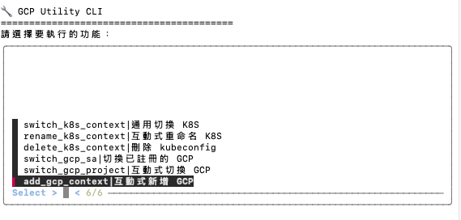
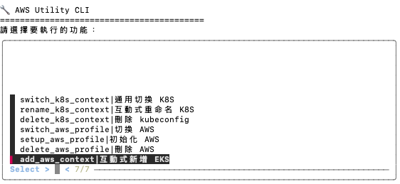

# Tools_Shell_CloudSwitch

提供 GCP / AWS 切換專案、身份模擬 (Impersonation)、Profile 管理，以及 Kubernetes 叢集與 Workload Identity 診斷的輔助 CLI 工具。

---

## ⚙️ 安裝與設置

### 快速安裝 (推薦)
在專案根目錄下直接執行安裝腳本，將自動偵測目前的 Shell (`bash` 或 `zsh`) 並將路徑加入設定檔中：

```bash
chmod +x install.sh
./install.sh
```

執行後請重新載入設定檔（例如 `source ~/.zshrc` 或 `source ~/.bash_profile`）即可。

---

### 手動安裝

#### GCP
```bash
# 注意：需於專案根目錄執行

# bash
echo 'export PATH="'$PWD'/gcp/bin:$PATH"' >> ~/.bash_profile
source ~/.bash_profile

# zsh
echo 'export PATH="'$PWD'/gcp/bin:$PATH"' >> ~/.zshrc
source ~/.zshrc

# 啟動 GCP 工具
gutil
```

### gutil 互動選單 


#### AWS
```bash
# 注意：需於專案根目錄執行

# bash
echo 'export PATH="'$PWD'/aws/bin:$PATH"' >> ~/.bash_profile
source ~/.bash_profile

# zsh
echo 'export PATH="'$PWD'/aws/bin:$PATH"' >> ~/.zshrc
source ~/.zshrc

# 啟動 AWS 工具
autil
```

### autil 互動選單 


---

## 專案結構
```bash
.
├── README.md
├── install.sh
├── aws
│   └── bin
│       ├── autil   # AWS 程式入口
│       └── cmds    # AWS 相關操作指令
│           ├── add_aws_context.sh
│           ├── delete_aws_profile.sh
│           ├── setup_aws_profile.sh
│           ├── show_aws_info.sh
│           └── switch_aws_profile.sh
├── common          # 通用元件與函式庫
│   ├── bin
│   │   └── cmds
│   │       └── convert_cron-timestamp.sh
│   ├── menu.sh
│   └── utils.sh
├── gcp
│   └── bin
│       ├── gutil   # GCP 程式入口
│       └── cmds    # GCP 相關操作指令
│           ├── add_gcp_context.sh
│           ├── gcp_sa_inspect.sh
│           ├── gcp_vm_inspect.sh
│           ├── switch_gcp_impersonate.sh
│           ├── switch_gcp_project.sh
│           └── switch_gcp_sa.sh
└── k8s
    └── bin
        └── cmds    # Kubernetes 相關操作指令
            ├── delete_k8s_context.sh
            ├── k8s_cronjob_trace.sh
            ├── k8s_helm_inspect.sh
            ├── k8s_node_disk.sh
            ├── k8s_pod_inspect.sh
            ├── k8s_pod_node.sh
            ├── k8s_workload_identity_inspect.sh
            ├── rename_k8s_context.sh
            └── switch_k8s_context.sh
```

---

## 🛠️ 主要功能亮點

* **AWS 管理 (`autil`)**：
  * AWS SSO Profile 初始化與快速登入驗證 (`setup_aws_profile`)
  * 互動式切換 AWS Profile (`switch_aws_profile`)
  * AWS Profile / SSO Session 批次清理 (`delete_aws_profile`)
  * 互動式查詢 AWS 常用資訊，包括 ALB 解析、Security Group 規則與 EKS Node Group (`show_aws_info`)
* **GCP 管理 (`gutil`)**：
  * 互動式切換 GCP Project 與 Service Account (`switch_gcp_project`, `switch_gcp_sa`)
  * GCP SA 模擬身份切換與生效驗證 (`switch_gcp_impersonate`)
  * 互動式查詢 GCP Service Account IAM 政策、角色與金鑰 (`gcp_sa_inspect`)
  * GCE 虛擬機詳細資訊檢視 (`gcp_vm_inspect`)
* **Kubernetes 工具 (`k8s/bin/cmds`)**：
  * GKE Workload Identity 雙向綁定診斷與修復建議 (`k8s_workload_identity_inspect`)
  * Helm Release 資源檢視與跨 Revision Diff 比較 (`k8s_helm_inspect`)
  * 節點磁碟使用率、Pod 資源佔用與 CronJob 執行排查 (`k8s_node_disk`, `k8s_pod_inspect`, `k8s_cronjob_trace`)
  * 互動式 Context 切換、重命名與刪除 (`switch_k8s_context`, `rename_k8s_context`, `delete_k8s_context`)
